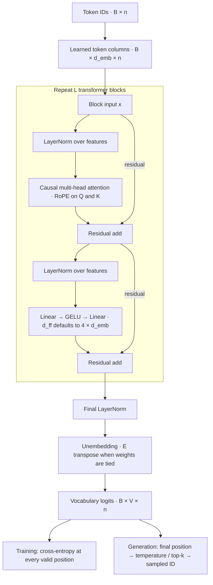

# Optimus

A small decoder-only language model built from explicit PyTorch matrix operations. The code covers tokenization, document-safe data preparation, training from random initialization, checkpointing, and text generation.

The implementation includes causal multi-head attention, rotary positional embeddings (RoPE), pre-LayerNorm residual blocks, a GELU feed-forward network, optional embedding/output weight sharing, and a per-layer KV cache. It does not use `nn.Transformer` or `nn.MultiheadAttention`. PyTorch provides tensor kernels, automatic differentiation, and optimizer/loss primitives.

No pretrained weights or completed language-quality benchmark are included. Small datasets and short training runs are useful for inspecting learning; generated text may be incoherent.

## Architecture and design decisions



| Decision | Reason and tradeoff |
| --- | --- |
| Explicit matrix operations | Makes projections, normalization, masking, and attention inspectable. PyTorch supplies tensor kernels, autograd, cross-entropy, and AdamW; no `nn.Transformer` is used. |
| Token vectors are columns | Hidden states are `(B, d_emb, n)` and every projection is `W @ X + b`. Keeping batch first matches PyTorch's last-two-axis matrix multiplication. |
| Pre-LN residual blocks | Each block computes `x + Attention(LN(x))`, then `x + MLP(LN(x))`. Residual paths help gradients pass through deep stacks; they do not guarantee training stability. |
| Causal multi-head attention | Each position attends only to its current/past keys. Heads use independent learned projections, with `d_k = d_emb / H`; dense attention has quadratic context cost. |
| RoPE on queries and keys | Encodes relative positional relationships through pairwise rotations without an additive position table. `d_k` must be even; extrapolating beyond training context is not guaranteed. |
| GELU MLP with default `d_ff = 4*d_emb` | Expands each token's features, applies a nonlinearity, and projects back. It transforms features independently at each position; attention provides token-to-token communication. |
| Optional tied input/output weights | Reuses `E.T` for vocabulary scoring, saving `V*d_emb` parameters. Untying is available for comparisons. |
| All-position next-token supervision | Shifted targets train many predictions in one pass. Documents are split first, the tokenizer fits training text only, and padded targets contribute no loss. |
| Per-layer KV cache for decoding | Prefills a prompt once, then processes only new tokens. At `n_max` the implementation rebuilds from the cropped window; paging and eviction are not implemented. |

See the [tensor notation reference](docs/NOTATION.md) for the equations, mask orientation, and all dimensions.

## Setup

From this directory, create an environment and install the core dependencies:

```sh
python -m venv .venv
source .venv/bin/activate
python -m pip install -r requirements.txt
python scripts/check_environment.py
```

Use Python 3.11 or newer. On Windows, activate with `.venv\Scripts\Activate.ps1` instead.

## Prepare the example corpus

The optional corpus uses three Project Gutenberg books. Download the original files, preserving their attribution and license text, then prepare fixed chapter/story splits:

```sh
mkdir -p data/gutenberg/raw
curl --fail --location https://www.gutenberg.org/cache/epub/11/pg11.txt --output data/gutenberg/raw/pg11.txt
curl --fail --location https://www.gutenberg.org/cache/epub/1661/pg1661.txt --output data/gutenberg/raw/pg1661.txt
curl --fail --location https://www.gutenberg.org/cache/epub/55/pg55.txt --output data/gutenberg/raw/pg55.txt
python -m scripts.prepare_corpus
```

The preparation script produces 40 training, four validation, and four test documents, plus a source/split/hash manifest. Each book appears in all three splits, so evaluation measures held-out sections of familiar books. See [corpus details](data/README.md). Downloaded text and generated datasets are excluded from version control.

## Train and generate

After preparing the corpus:

```sh
# Validate data, forward passes, evaluation, and checkpoint reload without updates.
python -m src.train --dry-run --eval-batches 1

# Train a small baseline; the test split remains reserved.
python -m src.train --run-dir runs/my-run --device cpu --max-steps 200 --num-threads 2

# Continue from the saved optimizer and random-number states.
python -m src.train --resume runs/my-run/latest.pt --max-steps 400

# Sample from the validation-selected model.
python -m src.generate --checkpoint runs/my-run/best.pt --prompt 'Alice ' --max-new-tokens 80 --top-k 10 --temperature 0.8 --seed 42

# Export model weights, configuration, and tokenizer without training metadata.
python -m src.train --export-model runs/my-run/best.pt --output runs/my-model.pt
```

`python -m src.train --help` lists model dimensions, optimization settings, evaluation cadence, and device options. `MODEL_DEFAULTS` and `TRAIN_DEFAULTS` in `src/train.py` supply shared defaults; CLI flags override them. Use `--manifest PATH` for another prepared corpus. A fresh run rejects a nonempty run directory to avoid overwriting previous results.

`--overfit-one-batch` reuses one fixed batch for debugging. Full validation is the default; `--eval-batches N` evaluates a reproducible subset for faster checks. Add `--test-final` only when the experiment is finalized: it evaluates the validation-selected model on the complete test split. CPU, Apple MPS, and CUDA are supported when available; measure a short run before choosing a device or training budget.

## Data flow and saved artifacts

```text
documents -> verified splits -> training-only tokenizer -> shifted token windows
          -> model logits -> cross-entropy -> backward pass -> optimizer update
checkpoint + tokenizer + prompt -> cached decoding -> top-k sampling -> text
```

- `src/data.py` verifies documents and produces input/target batches without crossing document boundaries. Every valid position predicts the following token; right-padded targets are ignored.
- `src/train.py` runs optimization, validation, early stopping, logging, and checkpointing. It checks causality, finite losses/gradients, clipping, actual weight updates, and checkpoint reloads.
- `src/generate.py` loads a model, encodes the prompt, samples new IDs, and decodes them. Training uses raw logits at every position; generation samples from the final position.

Each run contains `config.json`, `tokenizer.json`, `metrics.jsonl`, and `result.json`. Loss is averaged over valid target tokens; perplexity is `exp(loss)`. Processed-token counts include repeated examples and do not measure unique corpus size.

`best.pt` is selected by validation loss. `latest.pt` is the most recent resumable training checkpoint. Both retain training metadata, optimizer/random states, tokenizer vocabulary, and document identities; the resume metadata includes the local corpus manifest path. The separate model export contains inference configuration, weights, and tokenizer without that resume metadata. A checkpoint always needs its original tokenizer mapping; a new vocabulary cannot be substituted into existing weights.

## Architecture and limits

Hidden states use `(B, d_emb, n)`: each token is a column, and projections are `W @ X + b`. A block performs `x + Attention(LN(x))`, followed by `x + MLP(LN(x))`. Final LayerNorm and unembedding produce `(B, V, n)` logits. See the [tensor notation reference](docs/NOTATION.md) for all shapes and equations.

During cached generation, the prompt is processed once and subsequent calls process only new tokens. Each block reads its own stored keys/values. At the context limit, generation rebuilds the cache from the cropped window; this implementation has no cache eviction, PagedAttention, mixed-precision/distributed training, or EOS-based stopping. Dense attention still materializes token-pair scores. The regex tokenizer preserves words, punctuation, whitespace, and case; unseen validation/prompt tokens map to `<UNK>`.

## Inspect and verify

After preparing the corpus, run `python -m scripts.inspect_tokenizer`, `python -m scripts.inspect_layers`, `python -m scripts.inspect_attention`, or `python -m scripts.inspect_model` to print token alignment, tensor shapes, and cache behavior. These scripts use untrained weights to demonstrate mechanics.

```sh
python -m pip install -r requirements-dev.txt
python -m unittest discover -s tests -v
pyright --pythonpath .venv/bin/python
```

The tests cover masking, RoPE, gradients, full/cached equivalence, weight sharing, target alignment, inference exports, checkpointing, and exact CPU resume. They establish implementation behavior, not model quality. GitHub Actions runs the tests and type checking on Python 3.11. On Windows, give Pyright the interpreter path `.venv/Scripts/python.exe` instead.
